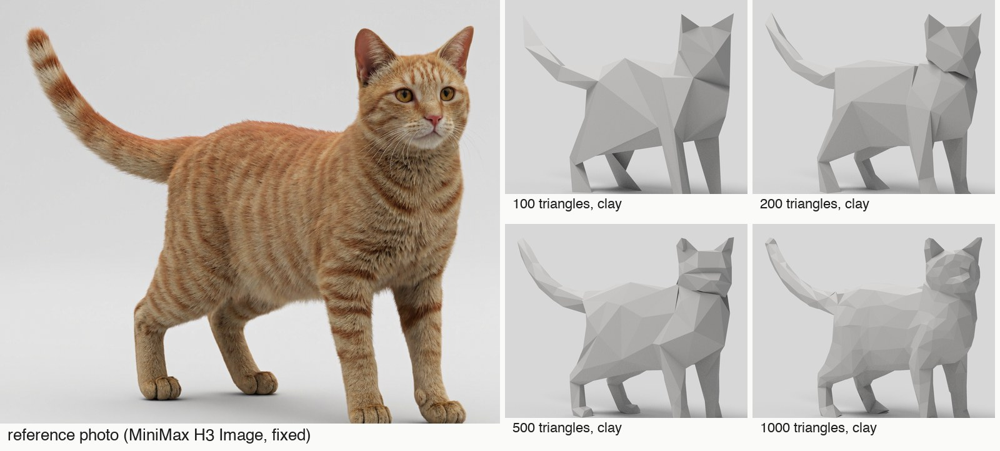
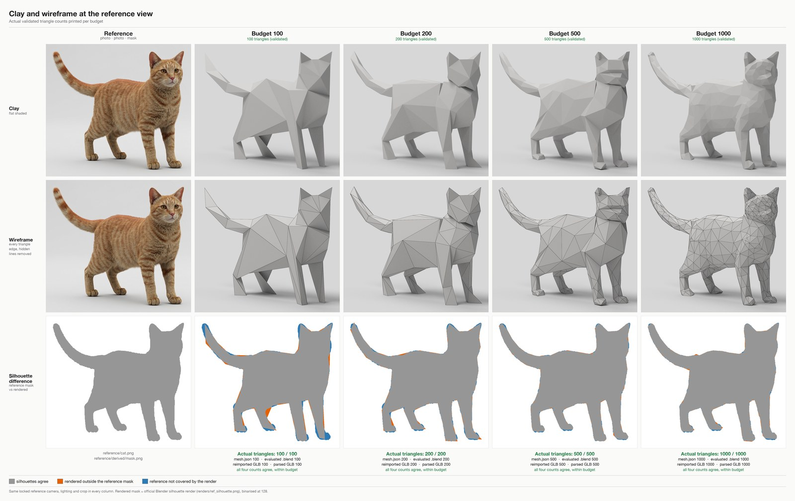
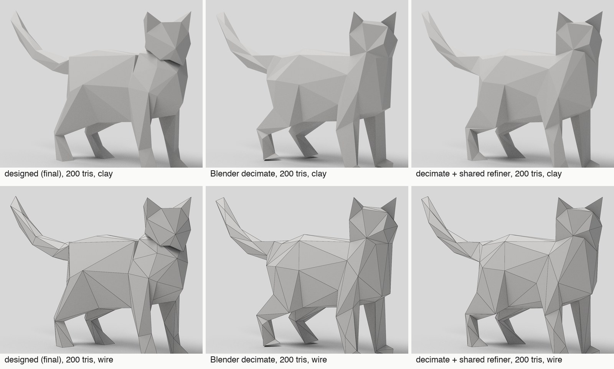
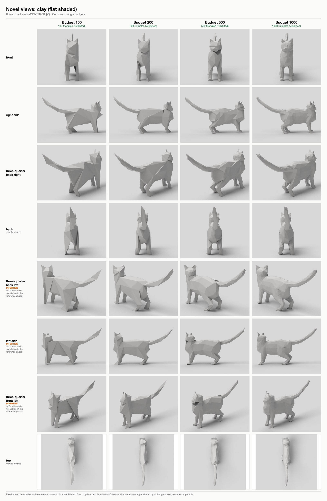
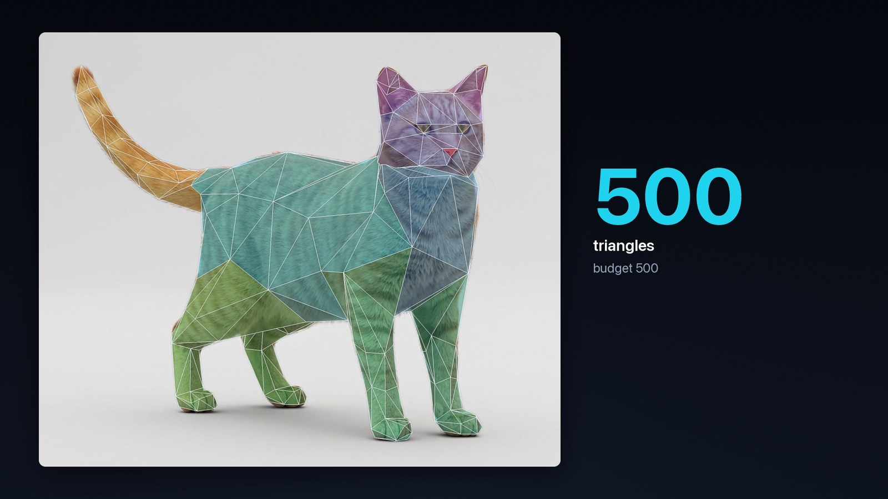

# Image 2 Low Poly

**Match one photo with exactly N triangles.** A skill for coding agents (Claude Code, Codex, Cursor, Copilot,
Gemini) that turns one reference photo of a subject into editable low-poly meshes under hard triangle budgets:
one locked camera fitted to the photo, an inferred solid for what the photo cannot show, a mesh per budget
whose triangles are allocated by hand and moved by a shared optimiser, and a count that is checked four
independent ways. The results are ordinary `.glb` and `.blend` files with one object each and no modifiers.

The next step after [Video 2 GLSL](https://github.com/gokayfem/shader-skills),
[Video 2 Blender Nodes](https://github.com/gokayfem/video-to-blender),
[Video 2 Physics](https://github.com/gokayfem/video-to-physics),
[Video to CSS](https://github.com/gokayfem/video-to-css),
[Image 2 Sculpt](https://github.com/gokayfem/image-to-sculpt) and
[Blockout 2 Real](https://github.com/gokayfem/blockout-to-real). Blockout 2 Real gives a grey scene real
materials and light and leaves its shapes alone. This one is only about shape: how close a fixed number of
triangles can get to one photo, and where the triangles should go.

<p align="center"></p>

<p align="center"><sub>The fixed reference (left) and the four accepted meshes in grey clay through the same locked camera. Silhouette IoU against the photo's mask: 0.943, 0.972, 0.983, 0.984. Every count is exact. The heads are the weakest part at every budget, and from the front all four bodies are too thin; both are described below.</sub></p>

## Why

Ask an agent for "a low-poly model of this cat in 500 triangles" and it will usually build something and say
500. The usual failures go unnoticed:

- the count is Blender's polygon count, so quads, n-gons, a Subdivision or Mirror modifier or a second hidden
  object carry triangles nobody counted;
- a billboard, an extruded silhouette or a photo projected onto a plane matches the reference view and is
  flat from everywhere else;
- a texture or vertex colours make a wrong shape look right in the beauty render;
- one score (silhouette IoU) passes visibly wrong geometry: a folded face, a beak, legs merged into one slab;
- parts are pushed through each other, so triangles are spent on surfaces buried inside the body and the
  joins show as steps and slabs;
- the target moves: a new reference, a re-drawn mask or a different camera per iteration, so a number
  improves without the mesh getting better;
- nobody checks whether a plain decimation of the same shape would have done as well.

This toolkit gives the agent a method and the tools to do it properly:

- **One fixed target.** The photo, its mask, the landmarks (ear tips, eyes, nose, paws, tail) and a few image
  windows (head, tail, legs, torso) are made once, hashed, and never changed. Every number in every table
  carries those hashes and the hash of the evaluation code.
- **One locked camera, one inferred solid.** The camera is fitted jointly with a parametric proxy of the
  subject, then locked. Everything the photo cannot show (the far side, the width, the belly, the depth of the
  head) is inferred once, in the proxy, so every budget approximates the same solid. It is labelled inferred
  everywhere.
- **Triangles only, counted four ways.** A mesh is a JSON file of vertices and triangles with a region and a
  material per triangle. The count is taken from that file, from the evaluated `.blend` (every object in the
  file), from the `.glb` re-imported into an empty scene, and from a plain parse of the `.glb`. All four must
  agree and be at most N. Duplicate, degenerate, hidden-object, billboard and over-budget cheats are hard
  failures.
- **Allocation is the work.** Each budget gets its own build script and its own table of where the triangles
  go, and compares at least two materially different allocations. A shared, seeded optimiser then moves
  vertices (never the count) against the silhouette, the landmarks and the proxy, so differences between
  budgets come from the allocation, not from tooling.
- **One closed surface.** Limbs, tail and ears are welded into the body, not pushed through it. This was the
  biggest fix of the first run.
- **Scored by a render, read by eye, checked by a stranger.** The official numbers come from a Blender render
  through the locked camera: IoU, symmetric boundary distance, landmark error, per-window IoU and the IoU of
  the gaps between the legs. A result counts as better only when these agree and the clay, wire and
  eight-angle renders look better. A fresh reviewer sees only the photo and neutral-named clay renders.
- **Against a control.** Every budget is compared with Blender's Decimate of the proxy to N triangles, and with
  the same decimation after the shared optimiser.

## Any subject?

| Input | What happens |
|---|---|
| One photo of a four-legged animal, whole body visible, plain background | the main path; validated on one cat |
| Another quadruped (dog, fox, horse) | the proxy template (torso, neck, head, two ears, four legs, tail) fits after changing priors; not tried |
| A biped, a bird, a character, an object | needs its own proxy template (`fit_camera_proxy.py`, `build_proxy.py` are cat-shaped); the counting, evaluation, refiner and render tools do not care |
| Several photos of the same subject | not supported; one view, one camera |
| A mesh you already have | skip the photo: decimation plus the shared refiner is the control here, and the counting and validation tools apply as they are |

Hidden-side geometry is inferred from priors, never verified. With one photo the far side, the body's width
and the head's depth are guesses, and the result can be wrong there in ways no metric sees.

## Install

**Claude Code** (plugin marketplace):

```bash
claude plugin marketplace add gokayfem/image-to-lowpoly
```

```bash
claude plugin install image-to-lowpoly@image-to-lowpoly
```

Or copy the skill: `cp -R skills/image-to-lowpoly ~/.claude/skills/`.

**Codex, Cursor, Gemini CLI, Copilot and other agents** (via [skills](https://github.com/vercel-labs/skills)):

```bash
npx skills add gokayfem/image-to-lowpoly
```

Or install by hand:

- **Codex:** copy `skills/image-to-lowpoly` to `~/.agents/skills/`.
- **Cursor:** copy it to `~/.cursor/skills/`, plus the rule in `adapters/cursor/`.
- **Copilot:** `gh skill install gokayfem/image-to-lowpoly image-to-lowpoly`, plus `adapters/copilot/`.
- **Gemini CLI:** `gemini extensions install https://github.com/gokayfem/image-to-lowpoly`.

**claude.ai:** zip `skills/image-to-lowpoly` and upload it under Settings > Capabilities > Skills.

**ChatGPT, Gemini Gems and other chat tools:** see [`adapters/`](adapters/).

Requirements: Python 3.10+ with `numpy`, `scipy`, `scikit-image`, `Pillow`, `opencv-python-headless` and `cma`
(`pip install -r requirements.txt`), Blender 5.2+ (`$BLENDER`, `blender` on PATH, or the macOS app) for
assembly, counting and rendering, and ffmpeg for turntables and the timelapse. No model API is needed after the
reference photo exists; the photo can come from anywhere.

## Use

Ask naturally, for example:

- *"Make low-poly models of this photo at 100, 200, 500 and 1000 triangles."*
- *"I need this fox in exactly 300 triangles for a game. Show me where the triangles go."*
- *"Is my 800-triangle cat really 800 triangles, and is it better than a decimation?"*

A case is a directory (layout in [`references/contract.md`](skills/image-to-lowpoly/references/contract.md));
every script takes `--case DIR` (or `LOWPOLY_CASE`). With `S=skills/image-to-lowpoly/scripts`:

```bash
python3 $S/preflight_reference.py --case cases/fox          # mask, landmarks, regions, overlays
python3 $S/fit_camera_proxy.py    --case cases/fox          # camera + parametric proxy (CPU, tens of minutes)
python3 $S/build_proxy.py         --case cases/fox && python3 $S/build_proxy.py --case cases/fox --lock
python3 $S/make_decimation_baseline.py --case cases/fox --budget 300
python3 cases/fox/variants/300/build.py --out cases/fox/variants/300/checkpoints/v0_initial/mesh.json
python3 $S/refine_vertices.py --case cases/fox --mesh .../v0_initial/mesh.json --out .../v1/mesh.json --flips
python3 $S/evaluate.py        --case cases/fox --mesh .../v1/mesh.json --views
python3 $S/finalize_variant.py --case cases/fox --budget 300 --checkpoint v1 --reason "..."
```

| Command | What it does |
|---|---|
| `preflight_reference.py` | foreground mask, landmark and region files from manual annotations, overlays to check by eye |
| `fit_camera_proxy.py` | CMA-ES fit of the camera and a parametric proxy (generalised cylinders) to the mask and landmarks |
| `build_proxy.py` | fuses the proxy into one watertight surface, its SDF and part labels; `--lock` locks the camera; `--sdf-only` rebuilds just the SDF |
| `make_decimation_baseline.py` | the two controls: Decimate of the proxy to N, and the same after the refiner |
| `refine_vertices.py` | the shared, seeded vertex optimiser; never changes the count; `--flips`, `--freeze-verts`, snapshots |
| `assemble_variant.py`, `validate_variant.py` | `mesh.json` to `.blend` + `.glb`; the four-way count and every hard failure |
| `evaluate.py` | assemble, validate, render through the locked camera, official metrics, history row |
| `render_variant.py` | silhouette, clay, wire, overlay, eight fixed views, turntables (the only script that renders) |
| `finalize_variant.py`, `aggregate_metrics.py` | copy a checkpoint to `final/` and re-score it; the cross-budget table that refuses mismatched hashes |
| `make_comparison.py`, `make_critic_packet.py`, `make_turntable_mosaic.py`, `make_comparison_blend.py` | comparison sheets, the blind reviewer's packet, turntable mosaics, one `.blend` with all budgets |
| `build_head_kit.py`, `fit_head_kit.py`, `make_head_renders.py` | the shared symmetric head at five levels of detail (cat-specific template) |
| `timelapse/` | the build timelapse drawn over the photo from real construction stages and optimiser snapshots |

Rendering is serialised through one lock (`catlib.gpulock`), taken inside the rendering Blender process
itself; everything else is CPU-only and may run in parallel.

## The first run

One cat, four budgets, on an Apple M4 with Blender 5.2.2 and Cycles. The reference is one 1536² photo of an
orange tabby generated once with MiniMax H3 Image on fal and never changed. Each budget was built by its own
worker; there were two full rounds and part of a third. **Mesh iteration was stopped by the user**, who
accepted the forms as they stood; the meshes below are the best validated checkpoints at that moment.

<p align="center"></p>

<p align="center"><sub>Clay, every triangle edge, and the silhouette difference against the photo's mask (orange: rendered outside the mask; blue: mask not covered). Under each column, the four counts: mesh file, evaluated .blend, re-imported GLB, parsed GLB.</sub></p>

Official numbers, all through the same locked camera (from
[`examples/cat/metrics/metrics.csv`](examples/cat/metrics/metrics.csv)). IoU and leg-gap IoU: higher is
better; boundary distance and landmark error: lower is better. "Decimate + refiner" is the stronger control.

| Budget | Mesh | Count (4 ways) | IoU | Boundary mean / HD95 | Sharp landmarks | Leg-gap IoU | Self-intersecting pairs |
|---|---|---|---|---|---|---|---|
| 100 | first build, unrefined | 100 | 0.769 | 18.9 / 45.5 px | 12.2 px | 0.641 | 72 |
| 100 | **final** `v3_welded` | 100 / 100 / 100 / 100 | **0.943** | **4.9 / 18.0 px** | **8.6 px** | 0.913 | 3 |
| 100 | Decimate | 100 | 0.884 | 10.7 / 38.0 px | 25.0 px | 0.845 | 0 |
| 100 | Decimate + refiner | 100 | 0.935 | 5.7 / 22.0 px | 12.3 px | **0.921** | 1 |
| 200 | first build, unrefined | 200 | 0.884 | 10.2 / 36.0 px | 9.1 px | 0.883 | 108 |
| 200 | **final** `v5u_untangled` | 200 / 200 / 200 / 200 | **0.972** | **2.4 / 8.0 px** | **5.2 px** | 0.956 | 0 |
| 200 | Decimate | 200 | 0.910 | 8.0 / 20.6 px | 9.4 px | 0.855 | 0 |
| 200 | Decimate + refiner | 200 | 0.967 | 2.8 / 8.5 px | 5.4 px | 0.956 | 0 |
| 500 | first build, unrefined | 500 | 0.916 | 7.7 / 27.8 px | 22.8 px | 0.894 | 28 |
| 500 | **final** `v3_nose` | 500 / 500 / 500 / 500 | **0.983** | **1.40 / 5.0 px** | 2.8 px | **0.976** | 95 |
| 500 | Decimate | 500 | 0.942 | 5.0 / 15.0 px | 6.4 px | 0.927 | 0 |
| 500 | Decimate + refiner | 500 | 0.983 | 1.43 / 5.0 px | **2.0 px** | 0.974 | 3 |
| 1000 | first build, unrefined | 1000 | 0.939 | 5.2 / 18.0 px | 13.5 px | 0.930 | 314 |
| 1000 | **final** `v7_body` | 1000 / 1000 / 1000 / 1000 | **0.984** | **1.29 / 5.0 px** | **1.6 px** | 0.974 | 4 |
| 1000 | Decimate | 1000 | 0.948 | 4.5 / 14.0 px | 5.1 px | 0.940 | 0 |
| 1000 | Decimate + refiner | 1000 | 0.984 | 1.32 / 5.0 px | 1.6 px | **0.979** | 6 |

Unrounded: at 500 the final's IoU is 0.98305 against 0.98259 for the control; at 1000 0.98436 against 0.98422,
and sharp landmarks 1.59 against 1.64 px. Every final is one connected, closed surface (one component, no open
or non-manifold edges); at 100 and 1000 one triangle is never visible from any of 162 directions.

What this says, honestly:

- **At 100 and 200 the designed mesh is ahead** of the refined decimation on IoU, boundary distance and
  landmarks. At 100 the decimation has no separate ears and a box for a head; the control still wins on leg
  gaps (0.921 against 0.913), the tail window and agreement with the proxy from other angles.
- **At 500 and 1000 it only ties the control** in the reference view: the differences are in the third or
  fourth decimal. The control is ahead on landmarks at 500 (2.0 against 2.8 px) and on leg gaps at 1000. The
  500 final also has 95 self-intersecting triangle pairs at its welded junctions.
- **The control agrees better with the inferred proxy from other angles at every budget** (novel-view IoU
  0.904 / 0.950 / 0.974 / 0.981 against 0.897 / 0.935 / 0.961 / 0.974). It is a decimation of that proxy, so
  this is partly by construction.
- **Most of each gain comes from the shared optimiser**, which the control also gets. Hand-placed topology
  buys readable parts (ears, paws, a modelled nose and eyes at 500) more than it buys numbers.

<p align="center"></p>

<p align="center"><sub>200 triangles three ways, clay above, wire below. The designed mesh (left) spends its triangles in rings along each part; the decimation (middle) spends them where the proxy curves; the refined decimation (right) is as close to the photo's outline. The designed head is turned away from the camera and sits on a step at the neck.</sub></p>

<p align="center"></p>

<p align="center"><sub>Every mesh from eight fixed angles. The left side, back and top are not in the photo and are inferred. From the front and the top every body is a thin slab: the proxy's torso was fitted at the narrow end of its prior, and every budget inherited it.</sub></p>

<p align="center"></p>

<p align="center"><sub>A frame of the build timelapse: the mesh drawn over the photo through the locked camera, coloured by region. Every frame is a real construction stage or optimiser snapshot of the mesh that was delivered.</sub></p>

What went wrong, and what was fixed:

- **Kits of parts.** In the first round every budget was built as closed parts (torso, legs, tail, ears)
  pushed into each other. Triangles were buried inside the body (161 of 1000, 16 %, at 1000), the joins showed
  as steps and slabs, and at 1000 the mesh lost to the control on every number. Rebuilding each budget as one
  welded surface fixed the bodies at every budget: at 100 IoU went from 0.923 to 0.943 and the leg gap opened
  (0.870 to 0.913); at 1000 the buried triangles went from 161 to 1.
- **The optimiser folds faces.** Pulling eyes and nose to their landmarks without symmetry folded the face into
  a cavity (500) or a fold between eye and nose (1000) while the score improved. Freezing the face interior
  fixed the cavity and spike at 500; nothing in the delivered meshes fixes the heads as such.

What was not finished: **the heads.** A shared, bilaterally symmetric head at five levels of detail (22 to
224 triangles) was designed and fitted to the photo once, with a correction for a depth error (the photo fit
had put it 3-5 cm too near the camera; it was rescaled about the camera centre, which moves it along the
viewing rays and changes no pixel). Kit-head versions of every budget exist as checkpoints, but the accepted
finals keep their original heads. A second blind reviewer, shown only the photo and the finals, called the
100 head a box with no muzzle, the 200 head faceless and turned up on a collar ledge, the 500 face a
horizontal shelf like a visor, and the 1000 head a featureless sphere. Its reviews are in
[`examples/cat/critic/`](examples/cat/critic/); it judged the 200 the best likeness per triangle.

Other limits:

- **One cat, one photo.** Validated on one subject. The proxy and its fitter are a quadruped-cat template;
  another subject needs its own.
- **The hidden side is inferred.** Body width, far side, belly and head depth come from priors, and the bodies
  read too thin from the front.
- **Tails** are flat from the front and back at 100 and 200.
- **Camera and scale are conventions** (85 mm, withers 0.25 m), not measurements.
- **Flat colours only.** The meshes carry a flat material per face (fur, cream, inner ear, eye, nose); they
  never stand in for geometry, and the evaluation uses clay and silhouettes only.

The full run report, both reviews, every budget's notes and allocation table, and the numbers are in
[`examples/cat/`](examples/cat/). The failures and the rule each became are in
[`references/lessons.md`](skills/image-to-lowpoly/references/lessons.md).

## Verification

| Check | Where | Needs |
|---|---|---|
| Package imports from this layout, every script compiles, the four shipped meshes have exactly 100 / 200 / 500 / 1000 triangles in `mesh.json` and in the parsed `.glb` | `tests/smoke.py` | Python only |
| Head kit: symmetric templates, welds onto rings of 4-12 sides, closed manifold, exact counts | `tests/test_headkit.py` | numpy |
| Mesh edits (flip, split, collapse, bridge) and the refiner on a synthetic target | `tests/test_refine.py --skip-blender` | numpy, scipy, scikit-image |
| Camera against Blender's projection (< 0.5 px), rasteriser against Blender ray casts, four-way count, every hard failure fires on a deliberately bad mesh | `tests/test_tooling.py` | Blender |
| Render script: every pass, the lock | `tests/test_render.py` | Blender, GPU |
| Whole pipeline on stand-in meshes, and the aggregation's refusals (mismatched hashes, over budget, disagreeing counts) | `tests/test_integration.py` | Blender, GPU, about 10 minutes |

```bash
python3 tests/smoke.py
```

The Blender suites were run and passed in the original project before any mesh was scored; in this
repository they were adapted to the new layout but **not re-run**. CI (`.github/workflows/checks.yml`) runs
the smoke check and compiles every script on Linux without Blender.

## Layout

```text
skills/image-to-lowpoly/   the skill: SKILL.md, references/, scripts/ (catlib library, CLIs, timelapse/)
examples/cat/              the worked case: photo, mask, landmarks, camera, proxy, four final meshes, notes, metrics, reviews
tests/                     smoke check; the original test suites (some need Blender)
adapters/                  prompts for assistants without skill support
gallery/                   README images from the cat run (clay, wire, and the timelapse over the photo)
```

## Credits

See [CREDITS.md](CREDITS.md). MIT licensed.
